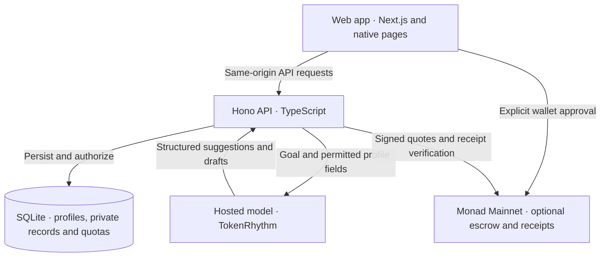

# SignalPass

**AI-assisted introductions for builder communities.**

Describe what you need help with. SignalPass suggests relevant people, shows the profile quotes behind each suggestion, and helps you write a first message. You review and send it; the recipient decides whether to continue.

Built first for **Monad builders**, with optional refundable attention bonds on Monad Mainnet.

[Open the app](https://signalpass.coderbojack.space/) · [Try the guided story](https://signalpass.coderbojack.space/v4/walkthrough.html) · [View the evidence](https://signalpass.coderbojack.space/v4/evidence.html)

## Start here

| Watch or try | Time | What you will see |
| --- | --- | --- |
| **[Product pitch](https://signalpass.coderbojack.space/media/signalpass-product-pitch-20261007-v3.mp4)** | 1:51 | The problem, who SignalPass serves and the product idea. |
| **[Working product demo](https://signalpass.coderbojack.space/media/signalpass-live-demo-20261007-v3.mp4)** | 2:53 | Two participants: discovery, an edited introduction, acceptance and contact sharing. |
| **[Interactive walkthrough](https://signalpass.coderbojack.space/v4/walkthrough.html)** | Self-paced | Try the same story without a wallet or account. |

[](https://signalpass.coderbojack.space/media/signalpass-demo-20261003.html)

The V3 films use edited production recordings with live AI, fictional participants, English narration and subtitles. Historical Monad transactions are shown separately. The interactive walkthrough uses prepared sample content; it makes no AI calls, sends no messages and moves no funds. [Watch page with both videos](https://signalpass.coderbojack.space/media/signalpass-demo-20261003.html).

## Why SignalPass?

Useful expertise may already exist in a community, but a member still needs to find the right person and explain why they are reaching out. A shared keyword is rarely enough.

**Example:** Alice needs feedback on a wallet prototype. Bob explicitly offers reviews of wallet connection and approval screens. SignalPass surfaces that offer and helps Alice turn it into a specific, modest request Bob can evaluate.

The initial audience is existing builder communities. An organizer-supported community plan is a business hypothesis to validate through an opt-in pilot; no customer traction or revenue is claimed.

## How it works

1. **Describe a goal.** Sign in with an Ethereum wallet and say what you need. You choose whether the assistant may use your approved profile. The sign-in signature is not a payment.
2. **Review people and evidence.** Inspect the reason, caveat and exact profile quotes behind a suggestion. Refine your goal if needed; no suitable match is a valid result.
3. **Edit and approve the introduction.** Make the private draft your own, then confirm delivery in a separate review. **Send without a bond is the default.** A bond requires an explicit choice and wallet approval.
4. **Let the recipient respond.** They can ask for context, accept or decline. After acceptance, each participant independently chooses whether to share contact or scheduling details.

**AI cannot send messages, accept introductions or spend funds on anyone’s behalf.** Acceptance does not automatically reveal contact details.

For a live two-person trial, use [the assistant](https://signalpass.coderbojack.space/assistant?demo=0) with two consenting participants and independent wallets. Candidate profiles must be approved, public and opted into matching. Rehearsal profiles were hidden after testing, so the live directory may return no match. [Pilot guide](docs/PILOT.md).

## Technical architecture

Discovery, drafts and no-bond introductions run off-chain. The optional bond path adds wallet-approved settlement on Monad.



| Layer | Implementation |
| --- | --- |
| **Web experience** | [`apps/web`](apps/web): Next.js serves the current HTML/CSS/JavaScript pages, stable routes and API proxy. |
| **Application API** | [`services/api`](services/api): Hono handles wallet-signature sessions, profile consent, matching, drafts, introductions and contact sharing. |
| **Storage** | SQLite with WAL stores profiles, sessions, private workspaces, introduction state and inference budgets. The live deployment uses one API process. |
| **Shared domain** | [`packages/core`](packages/core): TypeScript schemas, lifecycle rules, pricing and typed signing payloads. |
| **Monad contracts** | [`packages/contracts`](packages/contracts): Solidity/Foundry contracts for profile registration, introduction escrow and receipts; integrated through viem. |

The public site runs Next.js and the API as systemd services on a VPS behind a Cloudflare Tunnel. [Deployment guide](docs/VPS-DEPLOYMENT.md).

### How matching works

The API filters eligible public profiles and uses goal terms to shortlist up to **40 candidates**. The model returns **zero to three suggestions** with reasons, caveats and source quotes. The server checks the output schema, candidate identity, exact quotes and current profile permissions before returning results. Drafting is a separate request with fresh consent.

The public pilot uses **TokenRhythm `deepseek-v4-flash`**. Users need no personal model key or external agent installation. SignalPass sponsors up to **20 inference attempts per account and 200 site-wide per UTC day**; failed calls count. These are request limits, not a monetary spending cap.

Private drafts and contact details have account/participant access controls. Contact channels and inbox messages are excluded from model input. Profiles are self-reported, and exact quotation does not guarantee a correct explanation. The service does not provide end-to-end chat encryption or application-level encryption at rest. [Agent implementation and data boundaries](docs/HOSTED_AGENT.md).

The separate evaluator and Envio indexer packages are retained development components; recipient-side AI evaluation and a live Envio product index are not integrated.

## Monad’s role

An optional **refundable attention bond** gives a sender a way to commit funds while a request is considered. Contracts on **Monad Mainnet, chain 143** make the lock and settlement inspectable.

- **Accepted or declined:** the full bond returns to the sender.
- **Unanswered after expiry:** a resolution transaction is required to release it.
- **Costs:** gas is separate and is not refunded. The current manual-review path charges zero AI evaluation fee.

Bonds do not guarantee a reply, and their effect on spam or response quality remains unvalidated. [Deployed contract addresses](deployments/monad-mainnet.json) · [Bond design](docs/WALLET_BONDS.md).

## What has been verified

| Evidence | Result and scope |
| --- | --- |
| [Production journey](docs/reports/signalpass-public-journey-2026-10-07.json) | Two fictional accounts completed live AI discovery, edited-message delivery, acceptance and independent contact sharing. State survived refresh; this run used no bond. |
| [Matching evaluation](docs/reports/matching-live-2026-10-07/report.md) | 20 frozen fictional cases: relevant first result in **16/16** positive cases and correct abstention in **4/4** no-match cases. Strict success was **14/20**, versus **15/20** for BM25; weak extra suggestions reduced precision. |
| [Mainnet settlement](docs/reports/signalpass-mainnet-deployment-2026-10-03.md) | Project-owned wallets verified bond locks and full refunds on acceptance and decline. Expiry has local EVM coverage only. |
| [Latest release](docs/reports/no-bond-deployment-2026-10-12.json) | The no-bond default was deployed on October 12 and passed 15 origin checks after six mocked browser scenarios. |

These are engineering checks, not adoption evidence. The matching results do not establish overall superiority to keyword search; [reviewed explanations](docs/reports/matching-live-2026-10-07/claim-review.md) also contained unsupported claims. Real-user usefulness and physical-phone wallet handoffs still need validation.

[Public evidence overview](https://signalpass.coderbojack.space/v4/evidence.html) · [Evaluation methodology](docs/MATCHING_EVALUATION.md) · [Case-level results](docs/reports/matching-live-2026-10-07/results.json)

## Run locally

Requirements: **Node.js 22.13+** and **pnpm 10.32.1**.

```bash
git clone --recurse-submodules https://github.com/huaigu/twingate.git
cd twingate
pnpm install --frozen-lockfile
pnpm dev
```

Open **http://localhost:3004/**. The API and web app start together. The no-bond flow needs no chain; the prepared walkthrough is available at **http://localhost:3004/v4/walkthrough.html**.

Live AI is disabled until you configure a server-side provider using [the hosted agent guide](docs/HOSTED_AGENT.md). Export API configuration into the process environment; `.env` is not loaded automatically. Keep model credentials on the server.

For contract tests or the local bond flow, install Foundry and Anvil. Run `pnpm chain:dev` for the separate local EVM environment at **http://localhost:3005/**. See [development and verification commands](docs/DEVELOPMENT.md).

## Next steps

- Reduce weak secondary matches and unsupported explanations.
- Run a small opt-in community pilot and interview an organizer about usefulness.
- Validate wallet handoffs on physical phones.

## Project notes

[Development and tests](docs/DEVELOPMENT.md) · [Hosted agent](docs/HOSTED_AGENT.md) · [Pilot guide](docs/PILOT.md) · [Release checklist](docs/HACKATHON_SUBMISSION_CHECKLIST.md)

AI coding tools assisted implementation; the team reviews and integrates changes. The retained Git history begins on September 11, 2026. [Development provenance](docs/DEVELOPMENT.md#development-provenance) documents the original work and third-party foundations.

Licensed under [MIT](LICENSE). Third-party software, fonts and assets retain their own licenses; see [third-party notices](THIRD_PARTY_NOTICES.md).
