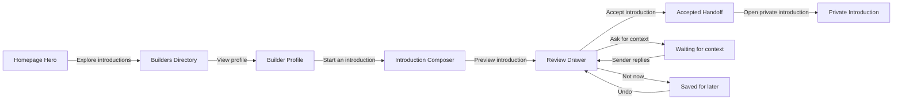

# SignalPass 设计稿与交互流转

这组设计稿用于讨论 SignalPass 的相关页面和首页 Hero 交互，不是已经实现的页面。所有图片都使用当前首页的纸张拼贴、哑光 3D Builder Persona、Monad 紫色信号线和编辑感排版作为统一视觉参考。

生成方式：内置 ImageGen 最新默认模型路径。当前文件夹共有 9 张 PNG，均为桌面端 16:9 视觉稿，尺寸约为 1672×941。

发现方式分成两层：当前 MVP 由用户在 Builders 目录中手动选择对象；黑客松目标允许 Personal Agent 根据公开 Profile 和用户目标给出少量、可解释的候选，但仍需用户确认后才能发起 Introduction。Personal Agent 的能力边界见 [Agent Surface](../../docs/SIGNALPASS_AGENT_SURFACES.md)。

## 页面主流程

## 设计稿清单

| 文件 | 页面或状态 | 用户从哪里进入 | 用户点击什么 | 点击后的结果 |
| --- | --- | --- | --- | --- |
| `01-builders-directory.png` | Builders 目录 | 首页 `Explore introductions` | Builder 卡片上的 `View profile` | 进入某个 Builder 的 Profile |
| `02-builder-profile-alice.png` | Alice Builder Profile | Builders 目录 | `Start an introduction` | 打开 Introduction Composer |
| `08-introduction-composer.png` | Introduction Composer | Builder Profile | 填写四个问题，再点 `Preview introduction` | 生成可审核的 Introduction Card；费用与 refundable bond 分开显示 |
| `04-hero-your-call-review.png` | Hero 的 Review Drawer | 首页 Hero 的 `Your call` | `Your call` | 原 Hero 保持在背景，右侧或底部打开纸张式 Review Drawer |
| `03-introductions-inbox.png` | Recipient Introductions Inbox | 顶部 `Your introductions` 或通知入口 | 选中某张 introduction | 主面板显示摘要、共同点和三种决定 |
| `09-hero-ask-for-context.png` | Ask for context 状态 | Review Drawer | `Ask for context` | 打开小纸张输入层；发送后状态变为 `Waiting for context`，介绍保持 pending |
| `05-hero-not-now-saved.png` | Not now 保存态 | Hero 或 Review Drawer | `Not now` | 卡片折叠到 `Later`，出现 `Saved for later` 和 `Undo`；动作可恢复 |
| `06-introduction-accepted.png` | 接受后的交接页 | Review Drawer | `Accept introduction` | 显示 `Introduction accepted`、`Private space unlocked` 和建议开场问题 |
| `07-hero-interaction-storyboard.png` | 交互分镜总览 | 设计评审用 | 无新增动作 | 汇总 Hero 的 hover、Review Drawer、Not now、Saved for later 四个关键画面 |

## Hero 按钮的具体流转

### `Your call`

1. 用户在 Hero 中看到 Alice 和 Bob 的 Introduction Card。
2. 鼠标悬停时，按钮轻微上移，紫色 signal pulse 从卡片中心亮起。
3. 用户点击 `Your call`。
4. 背景 Hero 轻微变暗，卡片抬升，纸张式 Review Drawer 从右侧或底部进入。
5. Drawer 显示共同上下文、双方简介、`Prepared privately by agents`，以及：
   - `Accept introduction`
   - `Ask for context`
   - `Not now`

`04-hero-your-call-review.png` 是这个状态的主视觉稿。

### `Ask for context`

1. 用户在 Review Drawer 点击 `Ask for context`。
2. 一个轻量纸张输入层展开，只允许写一个简短问题。
3. 用户点击 `Send question`。
4. Drawer 收起，原卡片显示 `Waiting for context`。
5. 介绍仍然处于 pending，不会自动接受，也不会打开私密空间。

`09-hero-ask-for-context.png` 表达输入层和等待态，`03-introductions-inbox.png` 表达收件箱里的等待状态。

### `Not now`

1. 用户点击 `Not now`。
2. Introduction Card 轻微折叠、缩小并移动到 `Later` 位置；signal line 降低亮度。
3. 页面底部出现 `Saved for later` toast，并提供 `Undo`。
4. 用户点击 `Undo`，卡片从 Later 回到原位置；不需要重新填写内容。

这个动作表达暂缓，而不是永久拒绝。对应稿件是 `05-hero-not-now-saved.png`。

### `Accept introduction`

1. 用户在 Review Drawer 点击 `Accept introduction`。
2. 卡片出现一个紫色确认印章，中央 signal bridge 展开。
3. 页面进入 `Introduction accepted` 状态。
4. 显示 `Private space unlocked`、双方已 opt in 的确认，以及一个建议开场问题。
5. 用户点击 `Open private introduction`，进入真正的私密介绍空间。

对应稿件是 `06-introduction-accepted.png`。这张图展示的是交接确认，不是完整聊天页面。

## 页面之间如何承接

- **Homepage → Builders**：首页只负责让用户理解“为什么值得认识别人”，主 CTA 进入 Builder 目录。
- **Builders → Profile**：目录卡片先展示正在做什么、能提供什么、想认识谁，再进入个人页。
- **Profile → Composer**：个人页的 `Start an introduction` 进入结构化写作，而不是直接打开聊天框。
- **Composer → Review**：发送前先预览；Evaluation Fee 和 Refundable Attention Bond 必须分开说明。
- **Review → Inbox / Accepted / Later**：收件人只看到 Agent 处理后的摘要，最终接受、追问或暂缓都由人完成。
- **Accepted → Private Introduction**：只有双方 opt in 后才打开私密介绍空间。

## 动效节奏建议

这些图是静态概念稿，动效可以按下面的节奏实现：

| 动作 | 动效 | 建议时长 |
| --- | --- | --- |
| Hover `Your call` | 按钮上移、紫色信号点亮 | 160–200ms |
| 打开 Review Drawer | Hero 背景淡暗，纸张面板滑入并带轻微错层 | 260–320ms |
| 打开 Ask for context | 小纸张输入层展开，原卡片保留在背景 | 220–280ms |
| 点击 `Not now` | 卡片折叠并移向 Later，toast 从底部进入 | 280–360ms |
| 点击 `Undo` | 卡片从 Later 回到原位置 | 220–300ms |
| 点击 `Accept introduction` | 确认印章出现，signal bridge 展开 | 320–420ms |

所有动作都应保留键盘焦点、清晰的状态文本和 reduced-motion 降级版本。Agent 的原始对话、Prompt、内部评分不进入这些前台状态。
